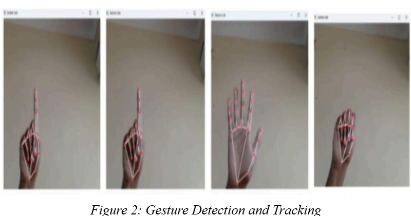
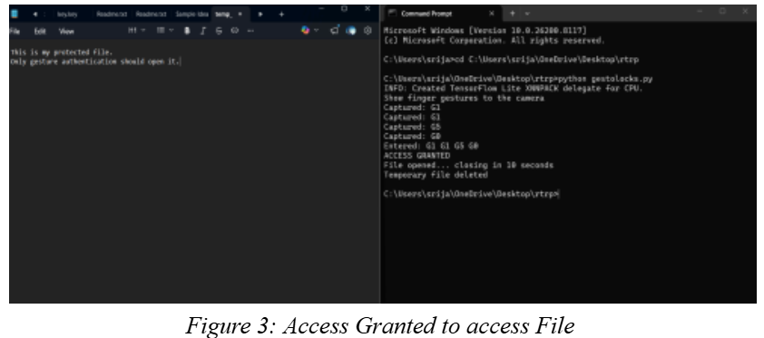

# Gesture Based Secure File Access System

[](https://www.python.org/)
[](https://opencv.org/)
[](https://developers.google.com/mediapipe)
[-green)](https://cryptography.io/)
[](https://www.microsoft.com/)

A biometric authentication and file protection system that secures sensitive files using real-time hand gesture recognition and symmetric cryptography. Instead of typing conventional alphanumeric passwords, users authenticate by presenting a sequence of hand gestures to a webcam.

Repository: [Nelapatlasrija123/Gesture-based-secure-file-access-system](https://github.com/Nelapatlasrija123/Gesture-based-secure-file-access-system)

---

## Table of Contents

- [Project Overview](#project-overview)
- [Problem Statement](#problem-statement)
- [Objectives](#objectives)
- [Key Features](#key-features)
- [Technologies Used](#technologies-used)
- [System Requirements](#system-requirements)
- [Project Structure](#project-structure)
- [Installation and Setup](#installation-and-setup)
- [How to Run](#how-to-run)
- [How It Works](#how-it-works)
  - [Gesture Encoding](#gesture-encoding)
  - [System Flow](#system-flow)
- [Screenshots](#screenshots)
- [Security Considerations](#security-considerations)
- [Future Enhancements](#future-enhancements)
- [Contributing](#contributing)
- [License](#license)

---

## Project Overview

The **Gesture Based Secure File Access System** introduces a vision-based physical authentication layer for securing local confidential data. By coupling computer vision (OpenCV and Google MediaPipe) with symmetric encryption (`cryptography.fernet`), the application captures real-time video frames from a camera, identifies hand landmarks, counts extended fingers, and parses a 4-gesture sequence passcode.

When the correct gesture combination is recognized, the system temporarily decrypts the target file, presents it to the user for a limited time window, and automatically wipes the plaintext file from disk to prevent unauthorized retention.

---

## Problem Statement

Traditional file access controls rely on standard authentication models that present distinct vulnerabilities:

1. **Keylogging and Keystroke Sniffing**: Alphanumeric passwords entered through physical keyboards can be intercepted by spyware and hardware keyloggers.
2. **Shoulder Surfing**: Observers can easily glance at keyboard strokes or PIN pads.
3. **Password Fatigue**: Users often select simple, repeated, or easily guessed passwords across multiple files.
4. **Permanent Plaintext Exposure**: Decrypted files are frequently left forgotten in temporary or desktop directories after viewing, exposing confidential information to subsequent users.

This project addresses these issues by offering a contactless gesture-driven authentication process that couples biometric physical interaction with automated temporary file lifecycle management.

---

## Objectives

- Develop a real-time computer vision pipeline to detect 21 hand landmarks using a standard consumer webcam.
- Implement a geometric algorithm to count raised fingers and translate them into distinct gesture tokens (`G0` through `G5`).
- Construct a 4-stage sequential passcode verification mechanism.
- Encrypt sensitive files using industry-standard symmetric cryptography (Fernet / AES-128-CBC).
- Implement an automated time-limited access window (ephemeral viewer) that deletes decrypted plaintext files automatically after inspection.

---

## Key Features

- **Dual-Engine MediaPipe Compatibility**: Built to work with both modern MediaPipe Tasks API (`0.10.15+`, with automatic download of `hand_landmarker.task`) and legacy MediaPipe solutions (`mp.solutions.hands`).
- **Interactive Visual Feedback**: Mirrored real-time webcam feed with rendered skeleton landmark overlays and connection lines.
- **4-Gesture Passcode Engine**: Collects a sequence of four finger poses, enforcing a 2-second pacing interval between gestures to prevent duplicate detections.
- **Dynamic First-Run Registration vs Verification**:
  - **First Run**: Automatically detects if no password exists and stores the newly recorded 4-gesture sequence into `password.txt`.
  - **Subsequent Runs**: Matches the user's live gesture sequence against the stored passcode to grant or deny access.
- **Authenticated File Encryption**: Encrypts plaintext documents using Fernet (128-bit AES in CBC mode with HMAC-SHA256 authentication).
- **Self-Cleaning Ephemeral File Access**: Decrypts the secret file to a temporary document (`temp_secret.txt`), displays it in the native operating system viewer, keeps it open for 10 seconds, and safely deletes it from storage.

---

## Technologies Used

| Category | Technology | Purpose |
| :--- | :--- | :--- |
| **Language** | Python 3.8+ | Core programming and script orchestration |
| **Computer Vision** | OpenCV (`opencv-python`) | Video capture, frame flipping, rendering landmark lines/points, GUI window display |
| **Machine Learning** | Google MediaPipe (`mediapipe`) | Hand landmark detection model extracting 21 3D hand keypoints |
| **Cryptography** | `cryptography` (Fernet) | Symmetric AES-128 file encryption, decryption, and key management |
| **Standard Libraries** | `os`, `subprocess`, `time`, `urllib.request` | Process management, file I/O, download automation, timing |

---

## System Requirements

### Hardware Requirements
- **Webcam**: Standard internal webcam or USB external camera (minimum 720p recommended).
- **Processor**: Intel Core i3 / AMD Ryzen 3 or higher (capable of real-time image processing at 15–30 FPS).
- **Memory**: Minimum 4 GB RAM.

### Software Requirements
- **Operating System**: Windows 10 or Windows 11 (the file viewer uses `os.startfile()`).
- **Python Version**: Python 3.8 to 3.12 (MediaPipe has optimal support in these releases).

---

## Project Structure

```text
Gesture-based-secure-file-access-system/
├── assets/                   # Project screenshots and visual demonstrations
│   ├── gesture_tracking.png  # Real-time hand landmark detection feed
│   └── access_granted.png    # Terminal authentication and decrypted file output
├── gestolocks.py             # Main gesture recognition, registration & authentication engine
├── encrypt_file.py           # Generates encryption key and encrypts plaintext into secret.enc
├── decrypt_and_open.py       # Decrypts secret.enc, opens viewer, and deletes temp file after 10s
├── open_protected_file.py    # Standalone wrapper to authenticate before launching a protected file
├── hand_landmarker.task      # MediaPipe Hand Landmarker model weights (auto-downloaded if absent)
├── key.key                   # Symmetric Fernet encryption key
├── password.txt              # Stored 4-gesture sequence passcode (e.g., "G1 G1 G5 G0")
├── secret.enc                # Encrypted ciphertext data
└── README.md                 # Project documentation
```

> **Note**: Virtual environment directories (such as `venv` or `gestolock_env`) and Python cache folders (`__pycache__`) are runtime-generated and should not be tracked in version control.

---

## Installation and Setup

### 1. Clone the Repository

```bash
git clone https://github.com/Nelapatlasrija123/Gesture-based-secure-file-access-system.git
cd Gesture-based-secure-file-access-system
```

### 2. Set Up a Virtual Environment

It is recommended to use an isolated Python virtual environment:

```powershell
# Create a virtual environment
python -m venv venv

# Activate on Windows (PowerShell)
.\venv\Scripts\Activate.ps1

# Or activate on Windows (Command Prompt)
.\venv\Scripts\activate.bat
```

### 3. Install Dependencies

Install the required packages directly using `pip`:

```bash
pip install opencv-python mediapipe cryptography
```

#### Creating a `requirements.txt` File
If your repository does not yet have a `requirements.txt` file, you can create one by running:

```powershell
@"
opencv-python>=4.8.0
mediapipe>=0.10.9
cryptography>=41.0.0
"@ | Out-File -Encoding utf8 requirements.txt
```

Future users can then install all dependencies in one command:

```bash
pip install -r requirements.txt
```

---

## How to Run

### Step 1: Encrypt Your Secret File

Before launching authentication, ensure you have an encrypted target file:

1. Create or place a file named `secret.txt` in the project root directory with your confidential text.
2. Run the encryption script:

```bash
python encrypt_file.py
```

This will generate:
- `key.key`: The symmetric encryption key.
- `secret.enc`: The encrypted binary output.

### Step 2: Register Your Gesture Passcode (First Run)

1. Make sure no `password.txt` file exists in the directory (delete it if resetting).
2. Execute the main program:

```bash
python gestolocks.py
```

3. Position your hand in front of the camera.
4. Show 4 consecutive gestures with your fingers (e.g., 1 finger, 1 finger, 5 fingers, closed fist).
   - The terminal will log each captured gesture (e.g., `Captured: G1`).
   - Each gesture is captured with a 2-second interval.
5. After 4 gestures are recorded, the window closes and your passcode is saved to `password.txt`.

### Step 3: Authenticate and Access the File (Subsequent Runs)

1. Run the main program again:

```bash
python gestolocks.py
```

2. Present the exact same 4-gesture sequence to the camera.
3. If the sequence matches:
   - Terminal outputs: `ACCESS GRANTED`
   - The application invokes `decrypt_and_open.py`.
   - `temp_secret.txt` is created and launched in your default text editor.
   - After **10 seconds**, the script automatically closes and deletes `temp_secret.txt`.
4. If the sequence does not match:
   - Terminal outputs: `ACCESS DENIED`
   - The file remains encrypted and locked.

---

## How It Works

### Gesture Encoding

The system tracks 21 hand keypoints and calculates whether each finger is open or closed based on relative landmark coordinates:
- **Thumb**: Evaluates horizontal tip coordinate (`x`) against the previous joint.
- **Index, Middle, Ring, Pinky**: Evaluates vertical tip coordinates (`y`) against the corresponding PIP joints.

| Finger Count | Gesture Code | Description |
| :---: | :---: | :--- |
| `0` | `G0` | Closed fist (no fingers extended) |
| `1` | `G1` | One finger extended (e.g., index finger) |
| `2` | `G2` | Two fingers extended (e.g., peace sign) |
| `3` | `G3` | Three fingers extended |
| `4` | `G4` | Four fingers extended (thumb folded) |
| `5` | `G5` | Open hand (all 5 fingers extended) |

### System Flow

```text
[Webcam Stream] ──> [OpenCV Frame Flip & BGR to RGB]
                           │
                           ▼
              [MediaPipe Hand Landmarker]
              (Extracts 21 3D Hand Landmarks)
                           │
                           ▼
                 [Count Open Fingers]
               (Evaluates Tips vs Joints)
                           │
                           ▼
          [Paced Capture (2s interval × 4)]
             Produces: "G1 G1 G5 G0"
                           │
             ┌─────────────┴─────────────┐
             ▼                           ▼
       [First Run?]                [Verification]
   (password.txt absent)         (password.txt exists)
             │                           │
    Save to password.txt         Compare live vs saved
                                         │
                         ┌───────────────┴───────────────┐
                         ▼                               ▼
                 [ACCESS GRANTED]                [ACCESS DENIED]
                         │                         (Exit/Lock)
          Decrypt secret.enc using key.key
                         │
          Write temporary: temp_secret.txt
                         │
             Open in OS Default Editor
                         │
                  Wait 10 Seconds
                         │
              Delete temp_secret.txt
```

---

## Screenshots

| Figure 2: Gesture Detection & Tracking | Figure 3: Access Granted & File Opened |
| :---: | :---: |
|  |  |
| *Real-time 21 hand landmarks tracking and 4-step sequence capture (`G1 G1 G5 G0`)* | *Console authentication verification, automatic file decryption, and ephemeral viewer* |

---

## Security Considerations

While this project showcases an innovative computer vision authentication mechanism, practical deployment requires understanding the following considerations:

1. **Key and Passcode Storage**:
   - In this prototype, `key.key` and `password.txt` are stored as plaintext files on local storage. In a production environment, keys should be protected using an OS keystore (such as Windows DPAPI or Credential Manager), and gesture passcodes should be hashed using salted algorithms (e.g., PBKDF2 or Argon2).
2. **Temporary Plaintext Lifecycle**:
   - The file is temporarily written to disk (`temp_secret.txt`) and deleted after 10 seconds via `os.remove()`. Standard deletion does not overwrite disk sectors; advanced forensic tools could theoretically recover un-shredded data.
3. **Environmental Vision Sensitivity**:
   - Lighting conditions, background noise, skin tone contrast, and hand orientation can occasionally affect landmark detection accuracy.
4. **Physical Replay / Observation**:
   - Gestures performed openly in front of a camera can be observed by onlookers in public areas.

---

## Future Enhancements

- [ ] **Hashed Passcode Storage**: Store gesture sequences as cryptographic hashes rather than plaintext strings.
- [ ] **Key Derivation from Gestures**: Use PBKDF2 to derive the file decryption key directly from the user's secret gesture sequence.
- [ ] **In-Memory Decryption**: Render decrypted documents directly in a GUI window (e.g., Tkinter or PyQt) without writing temporary files to disk.
- [ ] **Dynamic & Custom Gestures**: Add support for dynamic gestures (swipes, thumbs up/down, pinch gestures, and two-hand combinations).
- [ ] **Cross-Platform Compatibility**: Implement cross-platform file opening commands for macOS (`open`) and Linux (`xdg-open`).
- [ ] **Attempt Throttling**: Add a lockout timer after repeated failed authentication attempts.

---

## Contributing

Contributions, issues, and feature requests are welcome!

1. Fork the repository.
2. Create a feature branch:
   ```bash
   git checkout -b feature/AmazingFeature
   ```
3. Commit your changes:
   ```bash
   git commit -m "Add AmazingFeature"
   ```
4. Push to the branch:
   ```bash
   git push origin feature/AmazingFeature
   ```
5. Open a Pull Request.

---

## License

This project currently does not have an explicit open-source license assigned. If you intend to use or distribute this software, please consult the repository owner ([@Nelapatlasrija123](https://github.com/Nelapatlasrija123)) or open an issue to request adding an open-source license such as the [MIT License](https://opensource.org/licenses/MIT).
